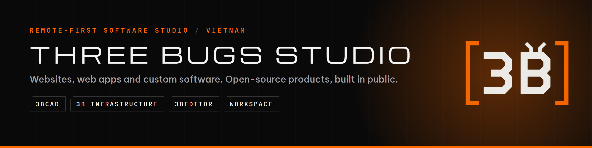

  

  <a href="https://3bstudio.me"><b>3bstudio.me</b></a> ·
  <a href="https://www.linkedin.com/company/three-bugs-studio">LinkedIn</a> ·
  <a href="https://unikorn.vn/u/duong-phu-dong">Unikorn</a> ·
  <a href="mailto:threebugstudio@gmail.com">threebugstudio@gmail.com</a>

We are a remote-first software studio from Vietnam. We design and build websites, web apps and custom software for clients in Vietnam and abroad, and we ship our own open-source products in public.

*Every bug teaches. Every build improves.*

## Our products

| Product | What it is | |
|---|---|---|
| [**3BCAD**](https://github.com/Three-Bugs-Studio/3bcad) | Parametric 3D CAD written in Rust: constrained sketches, solid features, assemblies, and a built-in 3D-print studio that sends parts straight to your slicer. Windows, macOS, Linux. |   |
| [**3B Infrastructure**](https://github.com/Three-Bugs-Studio/3binfrastructure) | A hand-drawn notebook on how software is built: architecture, databases, DevOps and 16 engineering subjects, each with an animated demo. | [Open the site](https://3binfrastructure.vercel.app) |
| [**3beditor**](https://github.com/Three-Bugs-Studio/3beditor) | A Claude Code plugin that edits your clips into a finished TikTok, Reels or Shorts video. English and Vietnamese. | [Install](https://github.com/Three-Bugs-Studio/3beditor#install-2-minutes) |
| [**Three Bugs Workspace**](https://github.com/Three-Bugs-Studio/threebugsworkspace) | An open-source workspace for studios and their clients: projects, feedback, files and audit logs in one place. | In development |

## Client work

- **H1T MICRO**: a nutrition platform tracking 22 micronutrients for more than 2,500 members. Go backend, Next.js frontend, Supabase, a cloud VPS. [#1 Product of the Day on Unikorn](https://unikorn.vn/p/h1t-micro?ref=embed-h1t-micro), Lighthouse 99 performance and 100 SEO.
- **Sukajan Store**: an online store with secure checkout for the PhiTruong brand launch. 98% SEO score, more than 15,000 visits, full source code handed over.

More on [3bstudio.me](https://3bstudio.me).

## What we build

| | From | Time |
|---|---|---|
| Website from a template | 2.5M VND | 2–3 working days |
| Custom-designed company website | 8M VND | 1–2 weeks |
| Online store and booking website | 25M VND | 3–6 weeks |
| Web apps, mobile apps and custom systems | quoted after a call | MVP in 6–10 weeks |
| Maintenance and upgrades | 300,000 VND / hour | as needed |

Prices are published on [3bstudio.me](https://3bstudio.me), with no hidden fees. Every project ends with the full source code in your hands.

## How we work

**Discover → Design → Build → Launch → Support.** We agree the scope in writing, design every screen in Figma, and give you a live staging link to test every week. You pay in milestones after checking each one, and every package comes with a free warranty.

## Stack

**Frontend** Next.js · React · TypeScript · Tailwind CSS · SvelteKit
**Backend** Go · FastAPI · NestJS · Node.js · Rust
**Data** PostgreSQL · Supabase · Cloudinary
**Infrastructure** Docker · GitHub Actions · Vercel · Linux VPS

## Work with us

Tell us what you want to build at [3bstudio.me](https://3bstudio.me) or [threebugstudio@gmail.com](mailto:threebugstudio@gmail.com).
